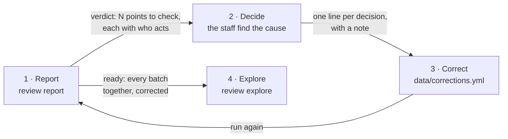
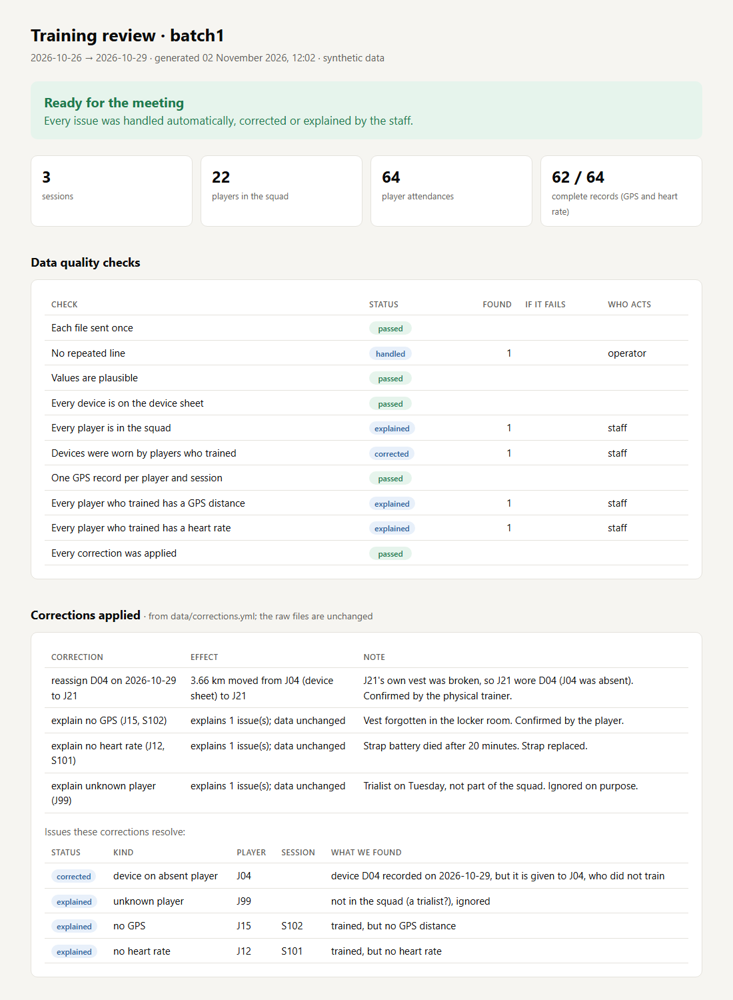
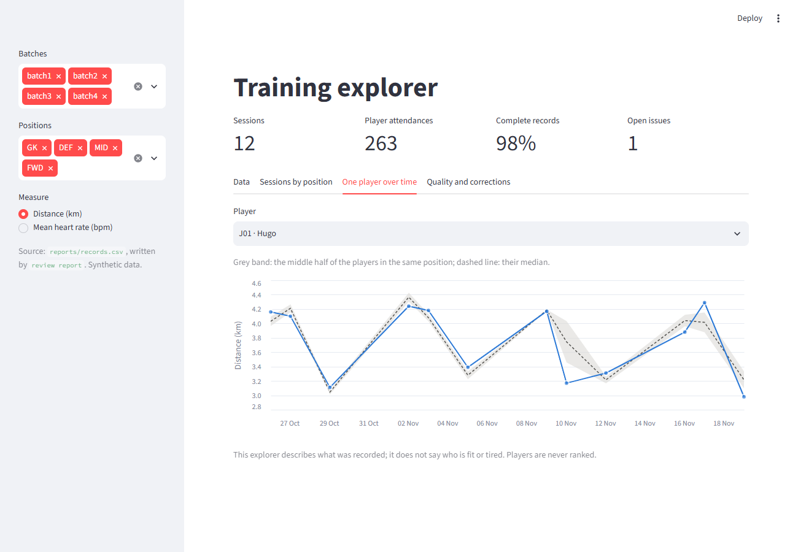

# Training review

Every week, a football staff receives a folder of files: the squad list, the attendance sheet, the device
sheet, GPS exports from two vendors, and heart-rate data. Merged by hand, they take hours, and the errors
stay hidden: kilometres added to metres, a device worn by the wrong player, a file counted twice, a gap
read as zero.

**Training review** checks each weekly batch, lets the staff correct what is wrong in a way anyone can
follow, and gives one clean, unified dataset to explore.

All data in this repository is synthetic.

## The weekly workflow



1. **Report.** `review report` reads a batch folder and writes a report that opens with a verdict:
   *ready for the meeting*, or *5 points to check*, each saying what was found and who acts.
2. **Decide.** The staff find the cause: who actually wore that vest, why that player has no GPS.
3. **Correct.** Each decision becomes one entry in [`data/corrections.yml`](data/corrections.yml), with a note
   saying who confirmed it. There are only two kinds:
   - `reassign`: a device was worn by another player that day. **The data changes**: the distance moves.
   - `explain`: the issue has a known cause. **The data does not change**: a gap stays a gap, with its reason.

   The raw files are never edited. Run the report again: every correction is listed with its effect
   ("3.66 km moved from J04 (device sheet) to J21"), and the issues it resolved stay visible, marked
   *corrected* or *explained*. A correction that matches nothing is flagged, never silently ignored.
4. **Explore.** `review explore` opens every batch, cleaned and corrected, in one page: the data table,
   sessions by position, one player over time, and the quality history.

| The report (one per batch) | The explorer (all batches) |
| --- | --- |
|  |  |

## Try it

You need [uv](https://docs.astral.sh/uv/).

```bash
uv sync
uv run review report data/samples/batch1 data/samples/batch2 data/samples/batch3 data/samples/batch4
uv run review explore
```

The reports are in `reports/batchN/report.html`. Batches 1 to 3 are ready, because their corrections are
already in `data/corrections.yml`. Batch 4 still has one point to check: J17 has no GPS on 17 November and
the staff have not answered yet. Add an `explain` entry for it and run the report again to see the verdict
change.

To see a batch as it arrived, before any correction: `uv run review check data/samples/batch1 --corrections none`.

Exit codes for a scheduled job: `0` ready, `1` points to check, `2` batch or corrections unreadable.

## What comes out

| File | Content |
| --- | --- |
| `reports/batchN/report.html` | verdict, quality checks, corrections and their effect, completeness, player × session overview |
| `reports/batchN/records.csv` | the clean table: one row per player and session, GPS in metres, a `note` from the staff |
| `reports/batchN/issues.csv` | every issue found, with its status (open, corrected, explained, handled) |
| `reports/batchN/corrections.csv` | every correction applied, and what it changed |
| `reports/records.csv`, `issues.csv`, `corrections.csv` | the same, every batch together: the unified dataset |

## Find your way

```text
data/samples/          four synthetic weekly batches, as the staff would send them (never edited)
data/corrections.yml   the staff's decisions about them
src/training_review/
  rules.py             value rules: decimal commas, km → m, plausible ranges. No I/O.
  formats.py           the files we can read, recognised by their columns. Add a vendor here.
  issues.py            the kinds of issue, and the quality check each one belongs to
  corrections.py       the corrections file: reassign and explain
  schema.py            the data contract of the clean table (pandera)
  pipeline.py          a batch folder and its corrections in, a clean table and its issues out
  quality.py           checks, completeness, verdict
  report.py            the HTML report and the CSV files; layout in templates/report.html
  explore.py           the explorer (Streamlit), reading the unified CSV files; charts in charts.py
  cli.py               the `review` command
tests/                 one test file per module, on the sample batches
scripts/               rebuilds the sample batches
docs/                  why and how, below
```

Start with `pipeline.py`: it reads top to bottom like the process it implements.

## Documentation

| Read this | To understand |
| --- | --- |
| [Product](docs/product.md) | who it is for, what they need, what we chose not to build, and how we measure success |
| [Pitch](docs/pitch.md) | the one page for a decision-maker: problem, proposal, cost, risks, the ask |
| [Architecture](docs/architecture.md) | the modules and the data flow, in diagrams |
| [Data](docs/data.md) | the source files, the clean table, every check, the corrections file |
| [Decisions](docs/decisions.md) | the choices made, and why |
| [Extending](docs/extending.md) | add a vendor, a check or a measure; run it every week |

## Develop

```bash
uv run pytest                                          # tests
uv run ruff check . && uv run ruff format --check .    # lint and format
```

CI runs the same commands on every push, and publishes the sample reports as an artifact.
