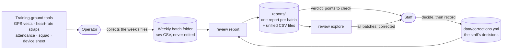
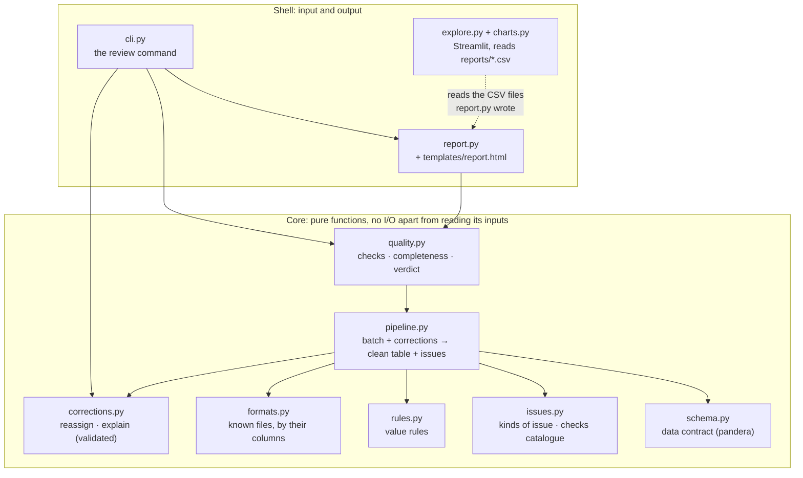
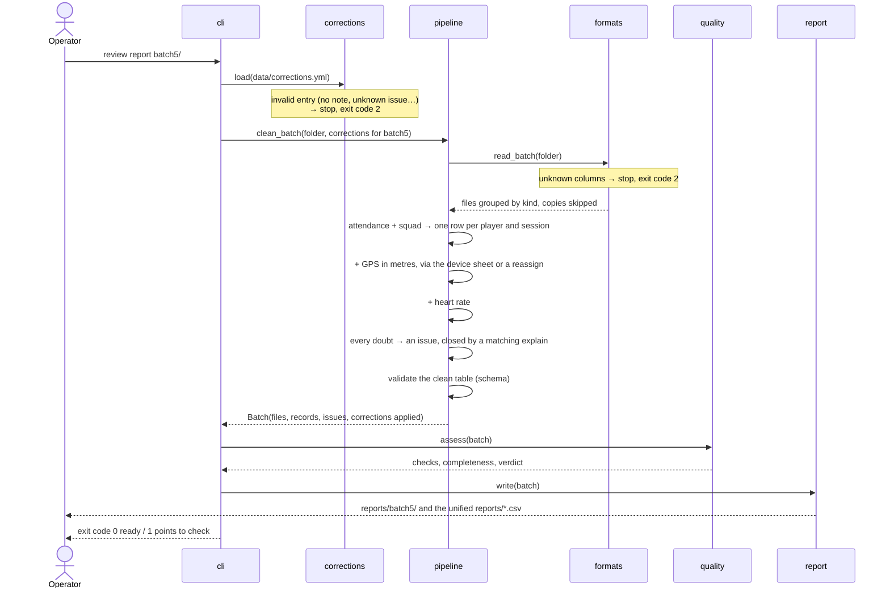
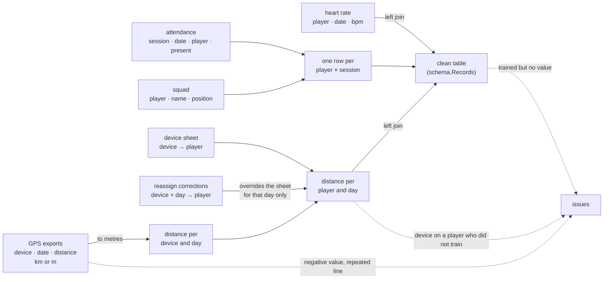
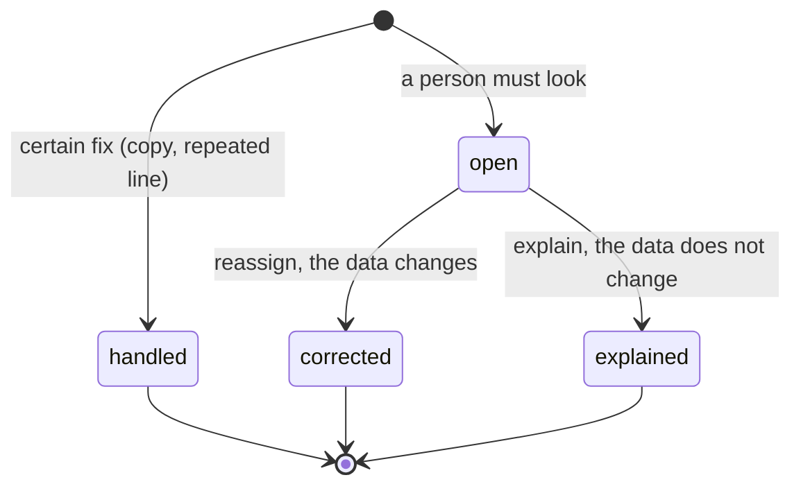

# Architecture

One idea shapes the code: **a pure core, a thin shell**. The core reads a batch folder and the corrections
file and returns data. It writes nothing and asks nothing. The shell (the command line, the report and the
explorer) handles input and output. The rules live in the core, so that is where the tests are.

## In context

Everything in `reports/` can be rebuilt at any time from the raw folders and the corrections file. Those two
are the only sources of truth, and both can be versioned.

## Modules

Dependencies only point down. The explorer does not call the pipeline: it reads what the reports wrote, so
what you explore is exactly what the reports say. Each module has one reason to change:

| When this changes… | …edit only |
| --- | --- |
| a vendor changes its export, or a new tool appears | `formats.py` |
| a plausibility rule (e.g. the heart-rate range) | `rules.py` |
| what a check is called, who acts, what to do | `issues.py` |
| a new kind of correction | `corrections.py`, and where it applies in `pipeline.py` |
| how files are merged | `pipeline.py` |
| what the clean table guarantees to its users | `schema.py` |
| how the report looks | `templates/report.html` |
| what the explorer shows | `explore.py`, `charts.py` |

## What happens in `review report`

## How the clean table is built

Left joins keep every player on the attendance sheet. A missing measurement stays an empty cell and becomes
an issue. It never removes the row and never becomes 0.

## The life of an issue

The verdict counts only **open** issues: *ready* when there are none. Resolved issues stay in the report and
in `issues.csv` with their status and the staff's note, so nothing disappears without a trace. A correction
that matches nothing raises its own open issue (*unused correction*).

## Engineering choices

- **Corrections as data, not code.** Decisions live in one YAML file, validated by pydantic (unknown fields,
  missing notes and unknown issue kinds are refused). It is easy to review in a diff and easy to version, and
  it is applied the same way every time.
- **Data contract.** `schema.Records` (pandera) states what the clean table guarantees: one row per player
  and session, distances ≥ 0, heart rates in range, known positions. The pipeline validates its own output,
  so a broken rule fails at once instead of showing a wrong number.
- **Configuration as data.** File formats and checks are declared in lists (`formats.FORMATS`,
  `issues.CHECKS`), not buried in `if` statements.
- **Static report, read-only explorer.** The report is one HTML file with no JavaScript, to open, print or
  archive. The explorer only reads CSV files, so it can never change the data.
- **Tests on realistic data.** The sample batches carry the real problems, and each test names the behaviour
  it protects (`test_an_explain_closes_the_issue_but_keeps_the_gap`).
- **Reproducible.** `uv.lock` pins every dependency, a seeded script generates the sample data, and CI runs
  lint, tests and the sample reports on every push.

The reasons behind these choices are in [decisions](decisions.md).
