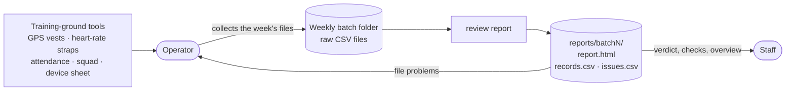
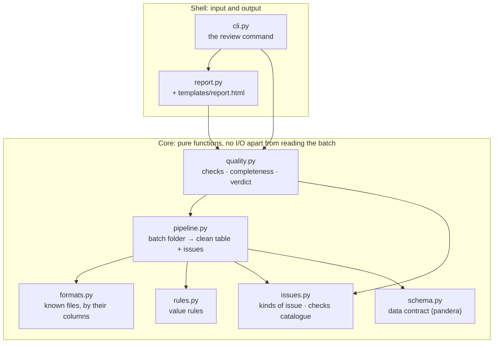
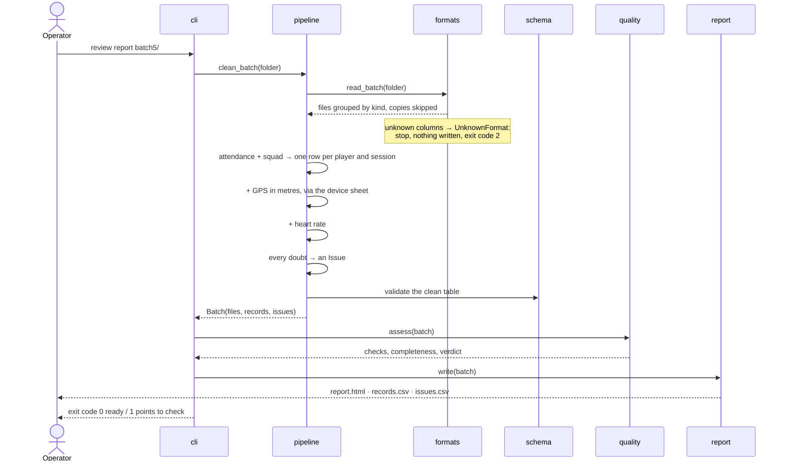
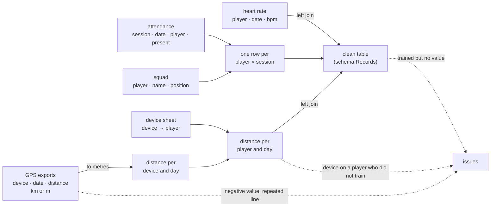
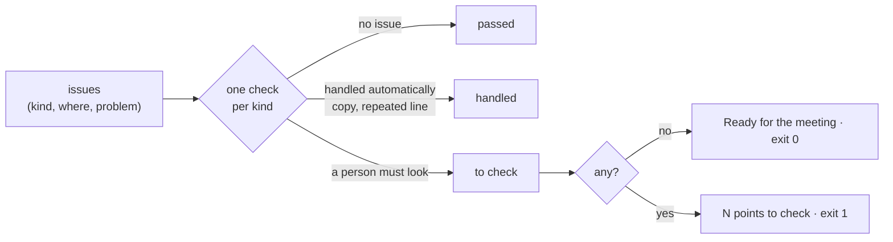

# Architecture

One idea shapes the code: **a pure core, a thin shell**. The core reads a folder and returns data; it
writes nothing and asks nothing. The shell (the command line and the report) does the input and output.
The core is where the rules live, so that is where the tests are.

## In context

The raw files are never modified. Everything the tool produces can be rebuilt from them at any time.

## Modules

Dependencies only point down. Each module has one reason to change:

| When this changes… | …edit only |
|---|---|
| a vendor changes its export, or a new tool appears | `formats.py` |
| a plausibility rule (e.g. the heart-rate range) | `rules.py` |
| what a check is called, who acts, what to do | `issues.py` |
| how files are merged | `pipeline.py` |
| what the clean table guarantees to its users | `schema.py` |
| how the report looks | `templates/report.html` |

## What happens in `review report`

## How the clean table is built

Left joins keep every player on the attendance sheet: a missing measurement stays an empty cell and becomes
an issue, it never removes the row and never becomes 0.

## Quality: from issues to a verdict

## Engineering choices

- **Data contract.** `schema.Records` (pandera) states what the clean table guarantees: one row per player
  and session, distances ≥ 0, heart rates in range, known positions. The pipeline validates its own output;
  a broken rule fails at once instead of showing a wrong number.
- **Configuration as data.** File formats and checks are declared in lists (`formats.FORMATS`,
  `issues.CHECKS`), not buried in `if` statements.
- **Static output.** The report is one HTML file with inline CSS, no JavaScript, no server. It can be opened,
  printed, archived or e-mailed as is.
- **Tests on realistic data.** The sample batches carry the real problems; each test names the behaviour it
  protects (`test_a_gap_stays_a_gap`).
- **Reproducible.** `uv.lock` pins every dependency; the sample data is generated by a seeded script; CI runs
  lint, tests and the sample reports on every push.

The reasons behind these choices are in [decisions](decisions.md).
